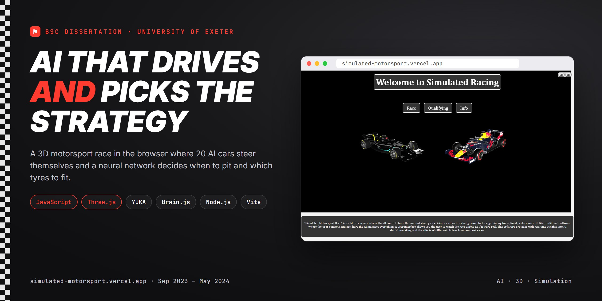

<a href="https://simulated-motorsport.vercel.app"></a>

<p align="center">
  <a href="https://simulated-motorsport.vercel.app"></a>
  
  
  
  
</p>

My final-year Computer Science dissertation at the University of Exeter (Sep 2023 – May 2024). It's a 3D motorsport race in the browser where **AI controls both the driving and the race strategy**. Most racing-management games let the AI drive while you make the strategy calls. Here the AI makes those calls too, and you watch the race unfold like a broadcast.

---

## 01 · What it does

- **Up to 20 AI cars** race on four selectable circuits, rendered in 3D with Three.js.
- **Qualifying** sets the starting grid.
- **A live timing tower** shows each car's position, speed, tyre compound and tyre wear.
- **2D and 3D views** of the same race.

## 02 · How the AI drives

Each car is a [YUKA](https://github.com/Mugen87/yuka) vehicle that follows a predefined racing line using **steering behaviours**: path following to stay on the line, and obstacle avoidance to race around the other cars. Three.js renders the cars and tracks from glTF models.

## 03 · How the AI picks the strategy

A **neural network trained with [Brain.js](https://brain.js.org)** decides, for each car, **when to pit** and **which tyre compound to fit**: soft, medium, hard or wet. It bases the decision on tyre wear and track conditions.

- **Training happens offline.** Node.js scripts ([`src/pages/node`](src/pages/node)) generate race data and train the network.
- **The trained model runs in the browser.** It's saved as [`trained_network.json`](src/pages/race/trained_network.json) and loaded by the race page, so no server is needed.

## 04 · Evaluation

The dissertation evaluated the simulation with a **user survey**. The survey is included as [`survey.pdf`](survey.pdf).

## 05 · Stack

| Layer | Tools |
| --- | --- |
| Rendering | Three.js, glTF models with Draco compression |
| Driving AI | YUKA steering behaviours |
| Strategy AI | Brain.js neural network, trained offline in Node.js |
| Build and hosting | Vite, Vercel |

## 06 · Run it locally

```bash
git clone https://github.com/KaloyanG17/Simulated-Motorsport.git
cd Simulated-Motorsport
npm install
npx vite
```

---

<p align="center"><sub>Designed and built by <a href="https://github.com/KaloyanG17">Kaloyan Gaydarov</a> · <a href="https://www.linkedin.com/in/kaloyan-gaydarov/">LinkedIn</a></sub></p>
